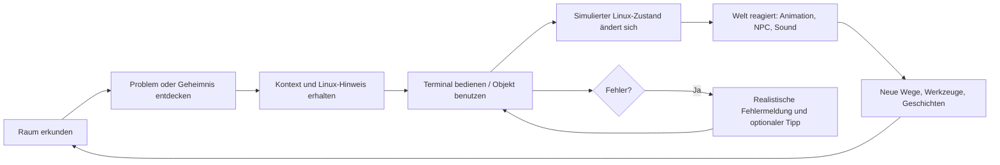
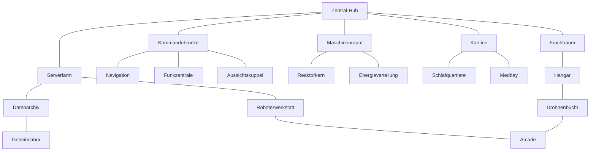
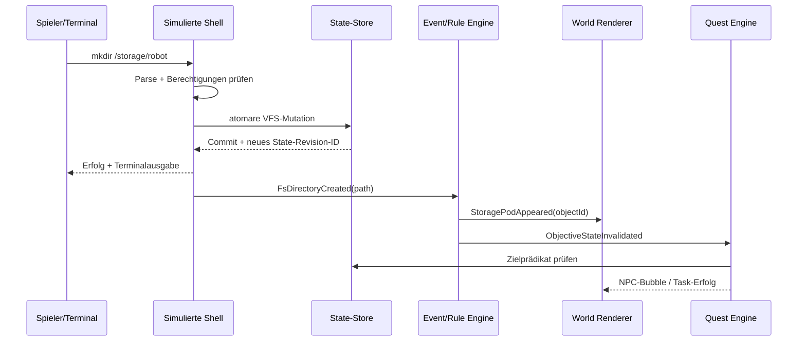
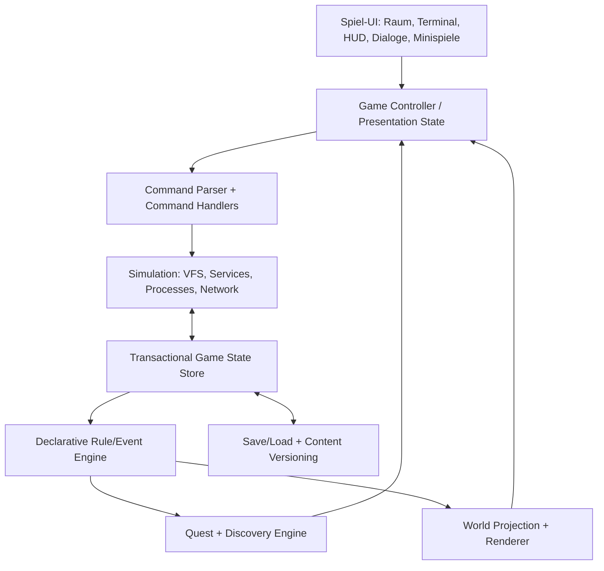

# Linux Space Pirates – Technische Gameplay-Spezifikation

**Version:** 1.0 · **Status:** Implementierungsvorgabe · **Sprache:** Deutsch  
**Zielgruppe:** Coding-Agent, Game-Design, Content-Autoren, QA  
**Projekt:** Bestehendes Linux-Lernspiel mit Linus als jungem Weltraumpiraten  
**Priorität:** Gameplay-Redesign und spielbarer Vertical Slice vor großflächiger Content-Produktion

> **Kernregel:** Ein unterstütztes Linux-Kommando verändert einen wohldefinierten Zustand eines simulierten Linux-Systems. Die Spielwelt visualisiert die daraus entstehenden Konsequenzen. Animationen dürfen Linux-Semantik nicht vortäuschen oder ersetzen.

---

## 0. Arbeitsauftrag an den Coding-Agenten

Implementiere aus dieser Spezifikation ein **halboffenes, erkundbares, farbenfrohes Weltraumspiel**. Der Spieler steuert **Linus**, einen jungen Piraten und Junior-Commander eines nach einem Angriff havarierten Raumschiffs. Er repariert, erforscht und verändert das Schiff durch **Linux-Kommandos in einer integrierten Konsole**. Jede relevante Aktion hat kurzes, sichtbares und akustisches Feedback. Die Story ist **nicht linear**; mehrere Systeme, Nebenquests und optionale Minispiele können parallel entdeckt werden.

**Vor jeder Codeänderung:**
1. Repository, bestehenden Technologie-Stack, Startbildschirm, Terminal-Implementierung, Navigation, Speicherung und Tests **lesen und dokumentieren**. Keine Engine, Sprache oder Architektur ohne Not austauschen.
2. Bestehende Inhalte nicht unkontrolliert löschen: altes Gameplay bei Bedarf per Feature-Flag deaktivieren oder Datenmigration definieren.
3. Eine dünne, vollständig testbare **vertikale Scheibe** implementieren: 4 Räume, ein NPC, 5 zusammenhängende Aufgaben, 8–12 Kommandos, visuelle Konsequenzen, ein Minispiel und mehrere Easter Eggs.
4. Erst nach Abnahme dieser Scheibe auf alle Räume, Module und LPIC-Lernpfade skalieren.
5. Nach jedem Arbeitspaket Build, Tests, Screenshots/Screenrecording (falls Umgebung vorhanden) sowie geänderte Dateien und bekannte Lücken dokumentieren. Keine Behauptung „fertig“ ohne verifizierte Akzeptanztests.

**Abgrenzung:** Diese Datei ist eine fachlich-technische **Soll-Spezifikation**, keine Aussage über bereits vorhandene Implementierungen. „Android/Kotlin/Compose/Room“ sind nur mögliche Integrationsbeispiele; bei einem anderen vorhandenen Stack die gleichen Schnittstellen und Verträge mit dessen Mitteln umsetzen.

## 1. Produktvision und Spielprinzipien

### 1.1 Zielbild

- **Entdecken statt durchklicken:** Das Schiff ist von Beginn an weitgehend frei begehbar; defekte Bereiche sind interessante Rätsel, keine künstlichen Kapitelmenüs.
- **Linux ist eine Superkraft:** Terminalbefehle sind das zentrale Werkzeug, keine isolierten Multiple-Choice-Fragen.
- **Verstehen vor Tippen:** Vor einer neuen Aufgabe ist ersichtlich, *was* kaputt ist, *warum* das Kommando hilft und *welche Linux-Funktion* es real besitzt.
- **Ursache und Wirkung:** `mkdir` erzeugt tatsächlich ein Verzeichnis im simulierten Dateisystem; ein daran angebundenes Hologramm zeigt den neuen Speicherplatz. `systemctl start` startet einen simulierten Dienst und kann dadurch reale Schiffsfunktionen aktivieren.
- **Poppig und schnell:** Einfache Interaktionen möglichst unter 10 Sekunden; kleine Aufgaben typischerweise 30–90 Sekunden; kurze Dialoge; Skip-/Schnelltextfunktion; überspringbare Effekte.
- **Freundlich, humorvoll, nicht belehrend:** Lustige NPCs, Easter Eggs und optionale Arcade-Aktivitäten, ohne das Lernen zu verstecken.
- **Lösungsfreiheit:** Wo immer sinnvoll prüfen Quests einen *erreichten Systemzustand*, nicht eine hartkodierte Kommandozeichenfolge.

### 1.2 Nicht-Ziele

- Kein Zugriff auf die echte Shell, Benutzerdateien, Netzwerke oder privilegierte Hostfunktionen über das Spielterminal.
- Keine vollständige Linux-Kernel- oder POSIX-Emulation. Es wird eine konsistente, deterministische, erweiterbare Teilmenge simuliert.
- Kein Zwang zu Echtgeld, Werbung, zeitbasierten Energiebalken oder einem permanenten Onlinekonto.
- Keine langen unüberspringbaren Erklärsequenzen und keine ausschließlich lineare Missionsliste.
- Kein separates, visuell wirkungsloses Quiz-Terminal als Hauptspielmechanik.

### 1.3 Spielschleife



### 1.4 Erfolgsmaßstäbe

| Metrik | Ziel für Vertical Slice | Messweg |
|---|---:|---|
| Sichtbares Reaktionsfeedback auf gültiges weltrelevantes Kommando | ≤ 300 ms für Start eines Effekts | Instrumentierter UI-Test |
| Vollständige leichte Aufgabenlösung | meist 30–90 s | manuelle QA/Playtest |
| Terminal-Kommandos ohne Host-Side-Effects | 100 % | Security-/Integrationstests |
| Questabschluss über Zustand statt festen Text | ≥ 80 % der Slice-Quests | automatisierte Tests |
| Reproduzierbarkeit nach Save/Load | 100 % der getesteten Questzustände | Roundtrip-Tests |
| Optionale Nicht-Linux-Aktivität im Slice | ≥ 1 Minispiel | manueller Test |

Die Zahlen sind **Design-/Abnahmekriterien**, keine behaupteten Ist-Werte.

## 2. Welt und erzählerischer Rahmen

### 2.1 Ausgangslage

Das farbenfrohe Piratenraumschiff **„Tux Fortuna“** treibt nach einem rätselhaften Zwischenfall zwischen Asteroiden. Die Systeme sind teilweise abgeschaltet, Konfigurationen verschwunden und Roboter benehmen sich seltsam. Linus, junger Pirat und Junior-Commander, hat noch Zugriff auf den lokalen Wartungsrechner. Die Crew ist über das Schiff verteilt und widerspricht sich in ihrer Erinnerung an den Vorfall.

**Langzeitmysterium:** Ein merkwürdiges Funksignal („**Pinguin-Ping**“) taucht in Logdateien, Navigationsdaten und beschädigten Backups auf. Erst nach optionalen und notwendigen Untersuchungen wird klar, ob Sabotage, ein Update-Unfall oder eine sehr eigensinnige Schiffs-KI verantwortlich war. Die Auflösung wird **durch Entdeckungen**, nicht durch starre Kapitel abgespielt.

**Ton:** Abenteuer und leichte Spannung mit Situationskomik; keine bedrohlichen Strafen nach Experimenten. Fehlversuche dürfen zu einem witzigen Zwischenfall führen, müssen aber reparierbar sein.

### 2.2 NPCs

| ID | Figur | Funktion | Beispielreaktion |
|---|---|---|---|
| `npc.linus` | Linus, Spielerfigur | Entdecker, repariert Systeme | Kommentiert eigene Erfolge und Fehlversuche knapp |
| `npc.boot` | **B0-OT**, flatterhafter Wartungsroboter | Kontext-Hilfe, adaptive Tipps | „Ich habe die Daten wegsortiert. Leider weiß ich nicht, wohin.“ |
| `npc.captain` | Captain Bytebeard | Übergreifende Story und Ziele | „Wer hat meine Brücke auf Stand-by gestellt?“ |
| `npc.chef404` | **Chef 404**, Kantinenroboter | Humor, Nebenquests | „Suppe nicht gefunden. Bitte prüfen Sie den Pfad.“ |
| `npc.patch` | Patch, Robotermechanikerin | Berechtigungen, Geräte, Werkstatt | Meldet Wartungsprobleme und Upgrades |
| `npc.echo` | Echo, Funkoffizier | Netzwerk, Logs, Pinguin-Ping | Erkennt versteckte Funksignale |
| `npc.ping` | Kleiner Pinguin mit Piratenhut | Geheimräume/Easter Eggs | Erscheint bei unerwarteten Kombinationen |

Dialoge sind **maximal 1–3 kurze Sprechblasen pro einfacher Interaktion**, danach spielbar. Zusätzliche Hintergrundtexte optional per „Mehr erfahren“.

### 2.3 Offene Erkundung, Gate-Design und Zustandsvarianten

- Startpunkt ist der **Zentrale Hub**. Von dort sind mindestens drei Bereiche ohne Questabschluss erreichbar.
- Weitere Räume sind durch *nachvollziehbare* Zustände eingeschränkt: kein Licht, keine Energie, keine Zugriffsrechte, ausgefallene Türen, fehlende Karte – niemals nur „Level 4 erforderlich“.
- Ein und derselbe Raum hat Varianten (z. B. `dark`, `emergency`, `powered`, `repaired`). NPCs und Objekte reagieren auf diese Zustände.
- Jede notwendige Blockade muss mit zuvor vermittelten oder im Spiel auffindbaren Linux-Konzepten lösbar sein.
- Mindestens 30 % der Entdeckungen bleiben optional; Hauptstory und Minispiele sind weitgehend unabhängig.

## 3. Raumkarte und vollständiger Weltkatalog

### 3.1 Raumgraph (logische Topologie)



*Der Graph definiert Spiel-Navigation, keine realen Linux-Pfade. Jede Kante bekommt in den Raumdaten eine Tür-ID, einen Weltzustand und gegebenenfalls eine erklärbare Bedingung.*

### 3.2 Raumdefinitionen

| Raum-ID | Raum und Look | Interaktionen / Linux-Lerninhalt | World-State-Effekt / Entdeckung |
|---|---|---|---|
| `hub` | **Zentral-Hub**: holografische Karte, bunte Wartungsleitungen, bewegliche Aufzüge | `pwd`, `ls`, Konsole, Karte, B0-OT | Zentrale Statusanzeigen und erste drei Aufgaben |
| `bridge` | **Kommandobrücke**: Panoramascheibe, Alarme, Steuerpulte | `systemctl`, `journalctl`, `ps` | HUD und Schiffsstatus werden aktiv |
| `navigation` | **Navigation**: Sternkarten, rotierende Projektoren | `cp`, `mv`, `cat` | Navigationsrouten erscheinen, Asteroidenkarte nutzbar |
| `communications` | **Funkzentrale**: Neonantennen, Signalwellen | `ip`, `ping`, `ss`, Logs | Funkverbindungen und Pinguin-Ping sichtbar |
| `observation` | **Aussichtskuppel**: riesiges Asteroidenpanorama | `date`, Zeit-/Logspuren | Aussichtsereignis, Asteroiden-Minispiel-Hinweis |
| `engineering` | **Maschinenraum**: Turbinen, Dampf, Förderbänder | `systemctl start/stop/status`, `journalctl` | Turbinen drehen sich real im Weltzustand |
| `reactor` | **Reaktorkern**: Plasmafarben, Schutzschilde | `systemctl`, Logs, Service-Abhängigkeiten | Energieversorgung / Notfallbeleuchtung |
| `power` | **Energieverteilung**: Kabel-Puzzle, Sicherungen | `cat`, `grep`, Dienstdiagnose | Systeme schalten sichtbar auf unterschiedliche Energiequellen |
| `server_farm` | **Serverfarm**: gläserne Racks, Datenströme | `mkdir`, `ls`, `df`, `du` | Neue *virtuelle* Datencontainer erscheinen |
| `data_archive` | **Datenarchiv**: stapelbare Hologrammkapseln | `find`, `grep`, `tar`, `cp` | Erhaltene Logspuren, Schlüsselfragmente |
| `robot_workshop` | **Roboterwerkstatt**: Montagearme, Funken, Laufbänder | `chmod`, `chown`, `id`, `groups` | Roboterzugänge, Upgrade-Werkbank |
| `arcade` | **Arcade**: flackernde Automaten, Retro-Neon | optional `man`, `help`, Easter Eggs | Minispiele, Kosmetik-Rewards |
| `canteen` | **Kantine**: Aliens, Kochroboter, Speiseautomat | `ls`, `cat`, `cp` | Essen wird ausgeliefert, lustige NPC-Reaktionen |
| `quarters` | **Crewquartiere**: schräge Schlafkapseln, persönliche Terminals | Benutzerrechte, `whoami`, `id` | Hintergrundgeschichten und Sammelobjekte |
| `medbay` | **Medbay**: medizinische Drohnen, Glastanks | Prozesse, `ps`, `kill` mit Sandbox-Regeln | Sanitätsdrohne reparieren, Nebenquest |
| `cargo` | **Frachtraum**: Container, magnetische Kräne | `mkdir`, `mv`, `cp`, `rm` | Inventarsortierung sichtbar, neue Wege |
| `hangar` | **Hangar**: Beiboote, Reparaturkräne | `systemctl`, Dateien, Netzwerk | Beiboot-Reparatur und Werkstatt-Optik |
| `drone_bay` | **Drohnenbucht**: Teststrecken, Steuerfelder | Prozess-/Netzwerkdiagnose | Drohnenrennen verfügbar |
| `secret_lab` | **Geheimlabor**: unheimlich-komische Experimente | zusammengesetzte Befehle, Logs, Rechte | Pinguin-Ping-Spuren, optionale Auflösung |

**Gesamt:** 19 Räume, davon `secret_lab` zunächst verborgen. Pro Raum im finalen Umfang mindestens 3 untersuchbare Objekte, 1 interaktive Geräusch-/Animationsreaktion und 1 ungewöhnliches Detail. Im Slice nur `hub`, `server_farm`, `engineering` und `canteen` vollständig implementieren; andere Türen können als klar gekennzeichnete Vorschau erscheinen.

### 3.3 Level- und Kameraanforderungen

- 2D/2.5D mit **isometrischer oder perspektivisch leicht gekippter Ansicht**; technischer Schwerpunkt auf stabiler Interaktion, nicht auf teuren 3D-Effekten.
- Modularer Aufbau: Boden, Wände, Vordergrund, Hintergrund, interaktive Geräte, NPCs, VFX, Beleuchtung und Zustandsvarianten als getrennte Ebenen.
- Schiffeinrichtung ist dicht und farbig, aber interaktive Objekte haben erkennbare Umrisse, Fokusmarker und zugängliche Hitboxen.
- Mindestens **3 animierte Objekte in jedem Slice-Raum**, mindestens ein Umgebungsereignis (Blinken, Roboterlauf, Dampf, Funksignal) pro Raum.
- Flüssige Kamera mit kurzer Fokusfahrt auf das Objekt, das durch einen Befehl verändert wurde; Option „Kameraeffekte reduzieren“.
- Raumwechsel schnell; kein vollständiger Neustart der Simulation und keine Verlust von Terminalzustand beim Wechsel.

## 4. UI, Steuerung und Terminalerlebnis

### 4.1 Hauptbildschirm

```text
┌───────────────────────────────────────────────────────────────┐
│ TUX FORTUNA       ENERGIE 43%       KARTE   AUFGABEN  [⚙]    │
│                                                               │
│   [Bunte erkundbare Raumansicht mit Linus und NPCs]           │
│                 ┌───────────────────────┐                     │
│                 │ B0-OT: „Meine         │                     │
│                 │ Daten fehlen!“       │                     │
│                 └───────────────────────┘                     │
│                                                               │
│ [Interagieren]  [Inventar]  [Konsole öffnen]                  │
├───────────────────────────────────────────────────────────────┤
│ TERMINAL · linus@tux-fortuna:/storage$                       │
│ $ mkdir robot                                                 │
│ [✓] /storage/robot erstellt · + Hologrammkapsel sichtbar      │
│ > _                                     [Tipp]  [Enter]       │
└───────────────────────────────────────────────────────────────┘
```

*Nur als schematisches Layout; auf schmalen Geräten Terminal als ausziehbares Bottom-Sheet oder Vollbild. Im Querformat optional Split-View.*

### 4.2 Bedienung

- Bewegen per Touch-Joystick, Tap-to-Move oder bestehender Navigation; Tastatur/Controller optional.
- Interaktions-Hotspots mit lesbaren Labels, Dialoge nach Bedarf.
- Terminal aufrufbar aus jedem Raum, wo Linus ein Wartungsgerät besitzt; das virtuelle Linux-System ist **global**, nicht pro Bildschirm isoliert.
- Terminal mit Geschichte (Pfeile), Verlauf, Tab-Vervollständigung für bekannte Pfade/Befehle, Cursorsteuerung, `help`/`man` und optionaler Vorschlagsleiste.
- **Anfängerhilfen in drei Stufen:** (1) Problemkontext; (2) Konzept-Hinweis; (3) Beispielsyntax. Lösungen nicht automatisch eingeben; Tutorials abschaltbar.
- Bei neuem Befehl einmal kurze Erklärung mit einem realistischen Beispiel; wiederholte Bedienung ohne Pop-up.
- Fehlermeldungen zuerst in standardnaher Form (`No such file or directory`, `Permission denied`) und darunter optional die kurze deutschsprachige Hilfe.
- Fokus, Prompt und Eingabefeld bleiben nach Ereignissen und Rückkehr aus Animationen erhalten.
- Screenreader: Weltobjekte mit Beschreibungen, Ereignisse als zugänglicher Text, terminalbasierte Alternativen zum Farbcode; skalierbare Schrift und Effektreduzierung.

### 4.3 Feedback-Kategorien

| Ergebnis | Sofortiges Terminalfeedback | Weltreaktion |
|---|---|---|
| `success_world` | normale Ausgabe + Mini-Badge „Schiffssystem verändert“ | kurze Partikelanimation, Kameraimpuls, NPC-Reaktion |
| `success_readonly` | authentische Ausgabe | dezente Hervorhebung/Scan-Overlay; keine falsche Mutation |
| `no_op` | realistische Ausgabe (z. B. Dienst läuft bereits) | kein erneuter Belohnungs-/Quest-Trigger |
| `recoverable_error` | Exit-Code und Fehlermeldung | optional humorvolle Reaktion, *keine* Erfolgsgrafik |
| `unsupported` | verständliche Meldung, unterstützte Alternativen | keine Mutation |
| `unsafe_blocked` | „In dieser Simulation nicht verfügbar“ | keine Host-Aktion, keine Mutation |

**Wichtig:** Effekte sind sekundär. Sie dürfen nicht verdecken, dass `mkdir` ein Dateisystemverzeichnis und keinen echten Server erzeugt.

## 5. Linux-Simulation: verbindliche Semantik

### 5.1 Sicherheitsmodell

Die Spielkonsole ist eine **isolierte virtuelle Shell**. Sie darf niemals Benutzereingaben per `Runtime.exec`, `ProcessBuilder`, `subprocess`, System-Shell, SSH, echten Socket oder echten Dateizugriff ausführen. Alle Kommandos durchlaufen einen internen Parser und eine **Allowlist** von Handlern. Es gibt keine `eval`-Ausführung, keine ungeprüfte Skript-Interpretation und keine Ausführung fremder Programme. `rm` wirkt ausschließlich auf virtuelle Objekte und ist durch Quest-Recovery abgesichert.

### 5.2 Virtuelle Linux-Domänen

- **VFS (Virtual File System):** Baum aus Dateien und Verzeichnissen; absolute/relative Pfade, `.`, `..`, Besitz, Gruppe, Mode, Inhalt, Dateityp, Größe; begrenzte Mounts.
- **Session:** Benutzer, Gruppen, aktuelles Arbeitsverzeichnis, History, Shell-Umgebungsvariablen im unterstützten Umfang.
- **Services:** systemd-inspirierte Unit-Registry mit `enabled`, `active`, `failed`, Dependencies und Journal; Services entsprechen glaubwürdigen Bordfunktionen.
- **Processes:** virtuelle PID-Tabelle für zum Spiel gehörende Prozesse; `ps`, `kill` und Prozesszustände sind simuliert.
- **Network:** virtuelle Interfaces, Adressen, Route-/Reachability-Graph, Sockets; keine echten externen Pings.
- **Devices/resources:** logische Speicherbelegung, Energiezustand, Schiffsmodule als World-State-Projektion aus VFS/Services/Network.
- **Clock/log:** deterministischer simulierter Zeitverlauf für Logs und reproduzierbare Aufgaben; tatsächliche Uhrzeit nur in optionalem HUD.

### 5.3 Kommandokatalog

**Stufe A – Slice (implementieren und testen):**

| Kommando | Mindestens unterstützte Syntax | Echte Simulationswirkung |
|---|---|---|
| `pwd` | `pwd` | gibt absoluten aktuellen Pfad aus |
| `ls` | `ls [path]`, `ls -l [path]`, `ls -a [path]` | listet reale VFS-Einträge, inkl. Rechten/Hidden-Files |
| `cd` | `cd [path]`, `cd ..`, `cd /` | ändert CWD nur bei vorhandenem les-/durchsuchbarem Verzeichnis |
| `mkdir` | `mkdir path`, `mkdir -p path` | legt VFS-Verzeichnis(se) an, Rechte/Parent prüfen |
| `touch` | `touch path` | Datei anlegen oder `mtime` aktualisieren |
| `cat` | `cat file` | Dateiinhalt ausgeben, Leserechte prüfen |
| `cp` | `cp src dst`, `cp -r dir dst` | VFS-Eintrag kopieren; Pfade/Rechte prüfen |
| `rm` | `rm file`, `rm -r dir` | virtuelle Einträge löschen; Schutzregeln beachten |
| `systemctl` | `systemctl status/start/stop UNIT` | Service-Registry verändern; Dependencies/Journal aktualisieren |
| `journalctl` | `journalctl -u UNIT`, `journalctl -n N` | virtuelle Systemlogs ausgeben |
| `help` | `help`, `help command` | Syntax-Hilfe und Beispiele |
| `man` | `man command` | Linux-Erklärung und praktischer Spielkontext |

**Stufe B – mittlerer Umfang:** `mv`, `find`, `grep` (einfache Muster, `-n`, `-i`), `chmod` (oktale und symbolische Rechte), `chown` (simulierte Adminrechte), `whoami`, `id`, `groups`, `df`, `du`, `ps`, `kill`, `ip addr`, `ping`, `ss`, `systemctl enable/disable/restart`, `date`.

**Stufe C – Erweiterungen/LPIC-Vertiefung:** `tar`, `mount`, `umount`, `useradd`, `groupadd`, `free`, `ip route`, `sort`, `head`, `tail`, `wc`, `cut`, Umleitungen (`>`, `>>`), eine sichere Teilmenge von Pipes (`|`), virtuelle Konfigurationsdateien und Service-Dependencies. **Nie** als Platzhalter mit falscher Semantik deklarieren.

**Nicht unterstützt in frühen Versionen:** beliebige Programme/Packages, Shellskripte, Command Substitution, beliebige Netzwerkadressen oder echte Superuser-Funktionen. `sudo` ist frühestens in Stufe B eine **virtuelle** Rechteeskalation mit expliziten Spielregeln.

### 5.4 Parser und Ergebnisvertrag

Tokenisierung muss mindestens Leerzeichen, einfache/doppelte Anführungszeichen und `\`-Escapes zuverlässig behandeln. Befehle, Optionen und Argumente werden getrennt. Vor dem ersten Release keine stillschweigende Interpretation von `;`, `&&`, `||`, `|`, Redirects oder Variablenexpansion; diese Syntax bis zur Implementierung explizit ablehnen.

```text
CommandRequest {
  rawInput: string,
  sessionId: string,
  timestamp: LogicalTime
}

CommandResult {
  stdout: string,
  stderr: string,
  exitCode: int,           // 0 Erfolg; sonst semantisch passend
  durationTicks: int,
  mutations: StateMutation[],
  domainEvents: DomainEvent[],
  helpHintId?: string
}
```

**Transaktionsregel:** Parser und Handler validieren zuerst. Zustand wird atomar mutiert, dann als `DomainEvent` ausgegeben; bei Fehler dürfen keine partiellen Mutationen zurückbleiben, außer wenn ein konkret modelliertes Standardverhalten das erfordert (z. B. `mkdir -p` wird als einzelne Transaktion behandelt).

### 5.5 VFS-Startzustand (Slice)

```text
/
├── home/
│   └── linus/
│       ├── welcome.txt
│       └── notes/
├── storage/
│   ├── inventory.csv
│   └── recipes/
│       └── soup.txt
├── var/
│   └── log/
│       └── ship.log
├── etc/
│   └── ship/
│       └── services.conf
└── usr/
    └── share/
        └── manuals/
```

- Session-Start: `user=linus`, `cwd=/home/linus`, passende Nutzer-/Gruppenrechte.
- `mkdir /storage/robot` ist nur erlaubt, wenn `linus` auf `/storage` Schreib- und Suchrechte hat. Für den Slice diese Rechte explizit setzen.
- VFS-Ausgaben sind stabil, alphabetisch sortiert, nachvollziehbar und nicht von der Host-Plattform abhängig.
- Jede Linux-Lektion hat **ein reales Ziel im simulierten System**; globale „magische“ Pfadschlüssel ohne VFS-Knoten sind untersagt.

### 5.6 Service-Startzustand (Slice)

| Unit | Initialzustand | Voraussetzung | Weltwirkung |
|---|---|---|---|
| `ship-lights.service` | active | `power-bus.service` active | Grundbeleuchtung an |
| `power-bus.service` | active | keine | Stromschienen animiert |
| `storage-index.service` | inactive | `/storage/robot` vorhanden | Speicherhologramm wird indiziert |
| `engine-cooling.service` | inactive | `power-bus.service` active | Kühlmittelkreislauf läuft |
| `engine-core.service` | inactive | `engine-cooling.service` active | Hauptturbine läuft |
| `galley-printer.service` | inactive | `power-bus.service` active + Rezeptdatei vorhanden | Essensdrucker kann drucken |

Die gesamte Wirkung wird über ein **einheitliches Zustandsmodell** abgeleitet. `systemctl start engine-core.service` bei fehlender Kühlung muss fehlschlagen oder den Service passend als `failed` markieren; es darf keine Turbinenanimation starten.

### 5.7 Linux-Wahrheit vs. Spielmetapher

| Aktion | Tatsächlicher Zustand | Spielerische Projektion | Nicht behaupten |
|---|---|---|---|
| `mkdir /storage/robot` | Verzeichnis existiert | neue holografische Lagerkapsel | „Ein echter physischer Server wurde erstellt“ |
| `ls /storage` | Inhalte gelesen | Scan hebt zugehörige Kapseln hervor | „`ls` erzeugt Dateien“ |
| `cd /storage` | CWD wechselt | Dateisystem-Map fokussiert Speicherbereich | „Linus teleportiert physisch“ |
| `cp recipe backup` | neue Datei/Kopie | Datenpaket fliegt zwischen Speicherstationen | „Es wird ein zweites Raumschiff gebaut“ |
| `chmod 640 config` | Mode-Bits ändern sich | Zugangsanzeige einer Konsole ändert sich | „`chmod` öffnet jede Tür“ |
| `systemctl start engine-core.service` | Service active, wenn Dependencies erfüllt | Turbine startet | „Dienst wurde trotz Fehlermeldung gestartet“ |
| `ping 192.0.2.2` | simulierte Netzwerk-Erreichbarkeit getestet | Signal fliegt entlang virtueller Leitung | „Echte Internetverbindung wird getestet“ |

### 5.8 Reversibilität und Fehlertoleranz

- Aufgaben prüfen **Endzustand**. Ein Spieler darf eine Datei beispielsweise über verschiedene erlaubte Kommandos erzeugen.
- Zerstörte Quest-Ressourcen können über im Spiel auffindbare Reparatur-/Restore-Mechanismen wiederhergestellt werden. Kein Softlock durch `rm` oder `stop`.
- Nach `systemctl stop` eines kritischen Systems ist Terminal weiterhin erreichbar (Notstrom-/Handheld-Lore).
- Erfolgreiche Questprämien werden **genau einmal** vergeben; mehrfaches Anlegen/Löschen gibt keine unbegrenzten Rewards.
- Fehler beim `mkdir` auf existierendem Verzeichnis erzeugen keine zweite Kapsel.

## 6. Ereignissystem und sichtbare Konsequenzen

### 6.1 Verarbeitungsfolge



### 6.2 Regeln für DomainEvents

1. **Event nach Commit**, nie vor erfolgreicher Mutation.
2. Jedes Event hat `eventId`, `correlationId` (Command-ID), `worldRevision`, `type` und `payload`.
3. World-Renderer und Quest-Engine müssen Events **idempotent** verarbeiten; z. B. `(worldObjectId, revision)` verhindert doppelte Kapseln.
4. Die Weltansicht wird aus **persistiertem Zustand rekonstruierbar**; Events dienen Animationen und schnellen Updates, sind nicht alleinige Wahrheit.
5. Regel-Auswertung erfolgt deterministisch, mit Cycle-Detection/Tiefenlimit; Effekte dürfen nicht unkontrolliert neue sich selbst auslösende Events erzeugen.
6. Regelwerke sind weitgehend **datengetrieben**: Pfad-/Service-Prädikate und Event-Mappings in Content-Dateien, nicht in einzeln verdrahteten Missionsfunktionen.

### 6.3 Basisevent-Typen

```text
FsDirectoryCreated(path, owner)
FsFileCreated(path, size)
FsFileCopied(source, destination)
FsNodeRemoved(path)
FsPermissionsChanged(path, oldMode, newMode)
ShellWorkingDirectoryChanged(oldPath, newPath)
ServiceStateChanged(unit, previous, current)
ProcessStateChanged(pid, previous, current)
NetworkLinkChanged(interfaceId, previous, current)
QuestObjectiveSatisfied(questId, objectiveId)
QuestCompleted(questId)
RoomDiscovered(roomId)
MiniGameCompleted(gameId, score)
SecretDiscovered(secretId)
```

Lesebefehle wie `ls` erzeugen **UI-Interaktionsevents** für Scan-Effekte, aber keine Domain-Mutation. UI-Reaktionen müssen direkt an das Terminalresultat gekoppelt sein und nicht im Savegame als Dateizustandsänderung landen.

### 6.4 Beispiel: Datenregel für Hologramm

```yaml
id: world.storage.robot_pod
worldObjectId: server_farm.pod_robot
roomId: server_farm
projection:
  visibleWhen:
    all:
      - fs.exists: /storage/robot
      - fs.type: { path: /storage/robot, equals: directory }
  appearance:
    absent: hidden
    present: holo_pod_glow
  onEnterState:
    present:
      animation: pod_materialize
      sound: ui.storage_materialize
      cameraFocus: server_farm.pod_robot
  fallbackText: 'Virtueller Datenspeicher /storage/robot vorhanden.'
```

**Hinweis:** Das Beispiel zeigt die deklarative Syntax als Vertrag; wenn das Repository bereits JSON/andere Formate verwendet, mechanisch gleichwertig abbilden.

### 6.5 Animation, Timing, Sound

- Nach relevantem Kommando: **0–300 ms** Beginn von Text-/UI-Feedback, sichtbare Weltanimation sobald Rendering verfügbar.
- Primäre Animation **0,3–1,2 s**, bei großen Maschinen bis ca. 2 s, jederzeit abbrech-/überspringbar.
- Feedback in drei Schichten: (a) Terminalresultat, (b) Objektzustand/-animation, (c) humorvoller NPC-Kommentar nur bei erzählerischer Relevanz.
- Soundeffekte in getrennten Gruppen (`ui`, `machines`, `npcs`, `arcade`) mit eigener Lautstärke und stummem Modus.
- Bei hoher Befehlsfrequenz Animationen **zusammenfassen** und zuletzt gültigen Zustand anzeigen; keine blockierende Warteschlange für 50 `mkdir`-Aufrufe.
- Für reduzierte Bewegung kurze Überblendung oder nur Statuswechsel.

## 7. Quests und nichtlineare Progression

### 7.1 Modell

Quests definieren **Auslöser**, **kontextuelle Hinweise**, **ein oder mehrere erreichbare Weltzustands-Prädikate**, **Belohnungen** und **optionale Folge-Hooks**. Wichtige Quests werden beim Erkunden entdeckt; ein Missionslog ist Hilfe, kein zentraler Level-Selektor.

```text
QuestDefinition {
  id, title, roomId, characters[],
  discoverWhen: Condition,
  objectives: Objective[],      // all/any, optional, hidden
  hints: Hint[3],
  consequences: RuleRef[],
  reward: Reward,
  repeatability: once | repeatable,
  storyFlagsOnComplete: string[]
}
```

Questzustände: `hidden -> discovered -> active -> completed` (optional `paused`). Kein Missionsabschluss allein, weil eine Dialogbox geschlossen oder ein bestimmter String eingegeben wurde.

### 7.2 Drei parallel startbare Hauptstränge

| Strang | Erste Fundstelle | Systemzusammenhang | Konvergenz |
|---|---|---|---|
| **Strom und Antrieb** | Maschinenraum | Services, Dependencies, Journals, Prozesse | Antrieb stabil / neue Schiffsrouten |
| **Daten und Erinnerungen** | Serverfarm | Dateien, Verzeichnisse, Kopien, Speicher, Rechte | Logfragmente und Pinguin-Ping-Hinweis |
| **Crew und Kommunikation** | Kantine / Funk | Pfade, Rezeptdateien, Netzwerkschnittstellen | Crew unterstützt Reparatur / Funkprotokoll |

Die Reihenfolge ist frei. Nach Abschluss zentraler Zustandsziele wird ein übergreifender Storybeat ausgelöst. Nebenaufgaben und Minispiele bleiben verfügbar.

### 7.3 Vertikaler Slice: fünf verknüpfte Aufgaben

**S1 – „B0-OT sucht seinen Speicher“ (Hub → Serverfarm)**  
B0-OT erklärt: Ein Speicherverzeichnis dient der Organisation von Dateien. Aufgabe: `/storage/robot` anlegen. **Lösung:** `mkdir /storage/robot` (oder äquivalent `cd /storage` + `mkdir robot`). **Check:** `fs.exists('/storage/robot') && fs.type == directory`. **Wirkung:** Hologrammkapsel erscheint in Serverfarm, B0-OT jubelt, Journal-/Hinweiskarte wird freigegeben. **Reward:** erste Wartungsplakette, genau einmal.

**S2 – „Ist der Index eingeschlafen?“ (Serverfarm)**  
Speicher ist angelegt, wird aber nicht gefunden. **Lösung:** `systemctl status storage-index.service`, dann `systemctl start storage-index.service`. **Check:** Dienst `active`, `/storage/robot` existiert. **Wirkung:** Datenleitungen leuchten und Scannerdrohne fliegt. `journalctl -u storage-index.service` zeigt passende Logs. **Unabhängigkeit:** Start des Dienstes vor Annahme der Quest zählt ebenfalls, sobald Zielbedingungen erfüllt sind.

**S3 – „Die überhitzte Turbine“ (Maschinenraum)**  
Eine Turbine steht; direkter Start des `engine-core.service` scheitert wegen fehlender Kühlung. Der Fehler verweist auf `engine-cooling.service`, und `journalctl` liefert Diagnose. **Lösung:** `systemctl start engine-cooling.service`, dann `systemctl start engine-core.service`. **Check:** beide Dienste `active`. **Wirkung:** erst Kühlkanäle blau, dann Turbine dreht sich und Brückenanzeige wird aktualisiert. **Wichtig:** Deaktivieren der Kühlung führt über Dependency-Regel zu nachvollziehbarem Folgezustand.

**S4 – „Chef 404 vermisst das Rezept“ (Kantine)**  
Der Essensdrucker verlangt `/storage/recipes/soup-backup.txt`, Original `/storage/recipes/soup.txt` existiert. **Lösung:** `cp /storage/recipes/soup.txt /storage/recipes/soup-backup.txt`, danach `systemctl start galley-printer.service`. **Check:** Backupdatei mit korrektem Inhalt vorhanden und Service aktiv. **Wirkung:** bunte Suppe wird gedruckt; Kochroboter startet lustigen Dialog. Ein bloßes `touch` der Datei genügt **nicht**.

**S5 – „Die Ursache in den Logs“ (Hub / verteilte Erkundung)**  
B0-OT zeigt Journal-Einträge aus Index, Turbine und Kantine; Spieler öffnet `journalctl -u ...` und findet drei Spuren. **Check:** drei Discovery-Flags nach tatsächlichem Anzeigen der relevanten Logblöcke (kein geheimer Eingabestring). **Wirkung:** Schiffs-HUD markiert neuen Untersuchungsort, ein „Pinguin-Ping“ erscheint. **Keine** Blockade anderer Quests nach S5.

**Questgraph:** `S1 -> S2`; `S3` und `S4` ab Start verfügbar; `S5` nach S2 plus mindestens einem weiteren entdeckten Log-Hinweis. Hauptstory-Fortschritt nach `S2 && S3 && S4` möglich, unabhängig von Abschlussreihenfolge.

### 7.4 Hinweise und Lernerklärungen

Zu jedem neuen Befehl gibt es ein kompaktes Konzeptfeld:

- **Warum?** „Die Turbine wird von einem Dienst gesteuert; der Dienst hängt von der Kühlung ab.“
- **Linux-Realität:** „`systemctl start` versucht, eine systemd-Unit zu starten. `systemctl status` zeigt ihren Zustand.“
- **Syntax:** „`systemctl start engine-cooling.service`“ als dritter, optionaler Tipp.

Hinweise dürfen zusätzlich aus lokaler Item-/NPC-Untersuchung stammen. Keine Bestrafung für häufige Hilfe.

## 8. Minispiele, Easter Eggs und optionales Metagame

### 8.1 Fünf Minispiele (Finalumfang)

| ID | Ort | Mechanik | Dauer / Rewards | Linux-Bezug |
|---|---|---|---|---|
| `asteroid_defense` | Aussichtskuppel / Brücke | Geschütz durch bewegliche Asteroiden steuern, Trefferketten | 1–3 min, kosmetischer Sternenlack | Zugang durch repariertes Zielsystem, nicht durch Quiz |
| `drone_race` | Drohnenbucht | kurze Hindernis-Parcours, Checkpoints | 45–90 s, Drohnen-Skins | optionale Diagnose vor Rennen |
| `power_circuit` | Energieverteilung | Leitungsstücke drehen und Stromkreise verbinden | 30–120 s, Dekoration | veranschaulicht Dependencies, ersetzt keine Linux-Aufgabe |
| `space_snake` | Arcade | klassisches Snake mit Weltraumobjekten | beliebig, Highscore | reines optionales Spaßspiel |
| `robot_builder` | Werkstatt | gefundene Bauteile zusammenstellen | 1–3 min, Begleiter-Optik | optionaler Zugriff auf Bauanleitung via `cat` |

Alle Minispiele: pausierbar, Touchsteuerung, kein zwingender Story-Fortschritt, Highscores lokal, Re-Entry ohne doppelte einmalige Quest-Rewards.

### 8.2 Slice-Minispiel: Space Snake

- 12×18 Gitter (oder proportional skalierbar); Bewegungsrichtung per Swipe/D-Pad; Tick-Rate beginnt bei ca. 5 Schritten/s und steigt moderat.
- Kollision mit Rand/eigenem Körper beendet Runde. Sammeln von Energie-Kristallen erhöht Score; Haptik und Sound optional.
- `MiniGameCompleted` mit `score` und `bestScore`, aber **kein Terminalkommando zur Spieleingabe**.
- Belohnung: bei erster Runde freies Schiffssticker-Set; nicht für Hauptstory erforderlich.

### 8.3 Easter Eggs

| ID | Trigger | Wirkung | Bedingung |
|---|---|---|---|
| `egg.sl` | `sl` in der virtuellen Konsole | kleine Dampflok fährt durchs aktuelle Terminalfenster | reines Easter-Egg-Kommando, kein Linux-Core-Befehl |
| `egg.cowsay` | `cowsay Hallo` | Weltraumkuh sagt „Hallo“ | dedizierte kleine virtuelle Implementierung |
| `egg.sudo` | `sudo` ohne Argumente | B0-OT salutiert übertrieben | kein Root-Zugriff ohne virtuelle Rechteprüfung |
| `egg.penguin` | drei versteckte Pinguin-Abzeichen | kleiner Pinguinraum wird auffindbar | Entdeckung optional |
| `egg.404` | Rezeptdrucker ohne Rezept inspizieren | Chef-404-Gag | nur einmal als Erstreaktion |

**Transparenz:** `sl`/`cowsay` als spielinterne Bonusprogramme kennzeichnen. Easter Eggs dürfen Linux-Kommandos nicht stillschweigend überschreiben. Auslösung pro Savegame nur für Entdeckungsprämien einmal; Wiederholung der Animation erlaubt.

### 8.4 Belohnungsökonomie

- **Primärer Reward:** Sichtbare Schiffsreparatur und neue Entdeckungsräume.
- **Sekundär:** kosmetische Sticker, Roboter-Looks, Logbuchseiten, Abzeichen, Musikstücke.
- Keine verbrauchbare Energie-/Hint-Währung, die Frust oder Grinding erzwingt.
- Belohnungen über stabile `rewardId` einmalig verbuchen; wiederholbare Minispiele dürfen Bestwerte steigern.

## 9. Technische Architektur und Schnittstellen

### 9.1 Schichtenmodell



**Trennungsregel:** Simulationskern und Questbedingungen sind **headless testbar**. Renderer und Animationen dürfen niemals Autorität über Datei-, Prozess-, Dienst- oder Questzustände besitzen. Ein Reload muss aus Savegame + Content-Definitionen dasselbe Schiff erzeugen.

### 9.2 Verantwortlichkeiten

| Modul | Verantwortlich für | Darf ausdrücklich nicht |
|---|---|---|
| `terminal-core` | Parser, Hilfen, Session, Kommando-Registry | echten Hostprozess starten |
| `linux-sim` | virtuelle Dateien, Rechte, Units, Prozesse, Netzwerk | grafische Widgets direkt verändern |
| `state-store` | konsistente Transaktionen, Revisionen, Snapshots | unvalidierte Benutzereingaben speichern |
| `event-engine` | stabile DomainEvents, Regeln, Idempotenz | zyklische ungebremste Mutation |
| `world-projection` | Datenprädikate → sichtbare Raumobjekte | Linux-Systemzustand aus Animation ableiten |
| `quest-engine` | Aufgabenbedingungen, Fortschritt, Rewards | nur Befehlsstrings auf Gleichheit prüfen |
| `story-engine` | Dialogauswahl, Flags, Entdeckungsfolgen | den Spieler unnötig linear einsperren |
| `minigames` | separate kleine Regelkreise, Score | Quest-Sim-Zustand unkontrolliert überschreiben |
| `persistence` | Save/Load, Migration, Repair, Autosave | inkompatible Spielstände stillschweigend löschen |
| `content-loader` | versionierte Räume, NPCs, Quests, Regeln | untrusted Code aus Content-Dateien ausführen |

### 9.3 Empfohlene Contracts (sprach-/frameworkneutral)

```text
interface CommandExecutor {
  execute(request: CommandRequest, snapshot: GameState): CommandResult
}

interface GameStateRepository {
  readSnapshot(): GameState
  transact(expectedRevision, mutations): CommitResult
  persist(): SaveResult
  restore(slotId): GameState
}

interface WorldProjector {
  project(roomId: RoomId, state: GameState): RoomViewState
}

interface QuestEvaluator {
  evaluate(state: GameState, changedDomains: Domain[]): QuestDelta[]
}

interface RuleEngine {
  evaluate(events: DomainEvent[], state: GameState): RuleEffect[]
}

interface ContentRegistry {
  loadAndValidate(contentVersion): ContentBundle
}
```

Für Android/Kotlin kann der Agent diese Verträge als Interfaces, Domain-Modell und ViewModels abbilden; für Godot/Unity/andere vorhandene Engines die entsprechende idiomatische Form. **Kein Engine-Rewrite ohne belegten technischen Grund.**

### 9.4 GameState als Quelle der Wahrheit

```text
GameState {
  schemaVersion: int,
  contentVersion: string,
  revision: long,
  randomSeed: long,
  session: ShellSession,
  fs: VirtualFileSystem,
  services: ServiceRegistry,
  processes: ProcessRegistry,
  network: VirtualNetwork,
  ship: ShipSystemState,
  quests: Map<QuestId, QuestProgress>,
  discoveries: Set<DiscoveryId>,
  storyFlags: Set<FlagId>,
  worldObjects: Map<ObjectId, PersistentObjectState>,
  rewardsClaimed: Set<RewardId>,
  minigames: Map<MiniGameId, MiniGameProgress>,
  player: PlayerState,
  settings: AccessibilityAndGameplaySettings
}
```

**Autoritative Felder** sind `fs`, `services`, `processes`, `network`, `quests`, Flags und Rewards. `ship` und `worldObjects` dürfen ausschließlich **eindeutig ableitbare, benannte Zustände** persistieren, die nicht aus den Autoritätsdomänen berechnet werden können (z. B. entdeckte Verstecke oder eingesammelte Dekoration). Abgeleitete Projektionen beim Laden **neu berechnen**, sonst widersprechen sich Welt und Linux.

### 9.5 Raum-/Objekt-/NPC-Schema

```yaml
id: server_farm
name: Serverfarm
scene: rooms/server_farm.scene
music: music/data_waltz
entryPoints:
  from_hub: { x: 2.0, y: 6.0 }
exits:
  - id: door_server_to_hub
    destination: hub
    unlockWhen: { always: true }
    lockedText: ''
objects:
  - id: server_farm.pod_robot
    asset: props/hologram_pod
    position: { x: 5.5, y: 3.2 }
    collision: false
    interactions:
      - type: inspect
        textKey: inspect.storage.robot
    projectedBy: world.storage.robot_pod
  - id: server_farm.index_console
    asset: props/index_terminal
    position: { x: 7.2, y: 4.8 }
    interactions:
      - type: terminalContext
        cwdSuggestion: /storage
        helpTopic: storage-index.service
npcs:
  - id: npc.boot
    spawnWhen: { questNotCompleted: quest.s1.storage }
ambient:
  - id: server_blink
    animation: server_rack_idle
    reducedMotionAnimation: server_rack_static
```

Validierungsregeln: alle IDs eindeutig; `scene`, `asset`, `textKey` und Referenzen vorhanden; keine Ausgänge in unbekannte Räume; keine unerreichbaren Quests ohne vorgesehene Sonderwege; keine inkonsistenten Condition-Typen.

### 9.6 Quest-Schema (Slice-Beispiel)

```yaml
id: quest.s1.storage
name: B0-OT sucht seinen Speicher
roomId: server_farm
discoverWhen:
  any:
    - interactedWith: server_farm.index_console
    - talkedTo: npc.boot
objectives:
  - id: create_robot_directory
    label: 'Lege /storage/robot an.'
    check:
      all:
        - fs.exists: /storage/robot
        - fs.type: { path: /storage/robot, equals: directory }
hints:
  - 'B0-OT braucht einen eigenen Ordner im Speicherbereich.'
  - '`mkdir` erstellt Verzeichnisse. Du kannst absolute oder relative Pfade nutzen.'
  - '`mkdir /storage/robot`'
rewards:
  onceId: reward.s1.badge
  badges: [first_storage_repair]
onComplete:
  - storyFlag: storage_ready
  - dialogue: npc.boot.storage_success
```

### 9.7 Deklarative Bedingungen statt freier Skripte

Erlaubte Prädikate in der ersten Version:

`always`, `all`, `any`, `not`, `fs.exists`, `fs.type`, `fs.contentEquals`, `fs.mode`, `service.state`, `network.reachable`, `quest.completed`, `room.discovered`, `storyFlag`, `interactedWith`, `talkedTo`, `minigame.bestScoreAtLeast`.

- Conditions ohne Seiteneffekte auswerten.
- Alle Daten beim Laden validieren; unbekanntes Prädikat ist ein **Content-Fehler**, keine stille `false`-Antwort.
- Regelbedingungen nicht über dynamisches `eval`, JavaScript oder nicht sandboxed Python interpretieren.
- Prädikate müssen für Tests als kleine reine Funktionen ausführbar sein.
- Bei Änderungen nur relevante Quests/Raumprojektionen reevaluieren (Domain-Invalidation), für Debug-Modus optional Full-Recompute und Konsistenzvergleich.

### 9.8 Einheitliches Mapping von Simulation auf Raumschiff

Eine zentrale Mapping-Tabelle/Condition-Konfiguration verbindet VFS-/Servicezustand mit dem Renderer. Beispiel:

```yaml
projections:
  - id: ship.power_lights
    source: { service.state: { unit: ship-lights.service, equals: active } }
    targets:
      - { roomId: hub, objectId: hub.main_lights, on: lights_bright, off: lights_emergency }
      - { roomId: server_farm, objectId: server_farm.strip_lights, on: lights_blue, off: lights_dim }
  - id: ship.engine_spin
    source: { service.state: { unit: engine-core.service, equals: active } }
    targets:
      - { roomId: engineering, objectId: engineering.main_turbine, on: turbine_spin, off: turbine_idle }
      - { roomId: bridge, objectId: bridge.engine_hud, on: status_online, off: status_offline }
```

Bei `systemctl stop engine-core.service` wird **derselbe Mechanismus** genutzt wie beim Start; kein speziell in die Engine-Szene eingebauter Stop-Hack.

## 10. Dialogsystem, Story-Autorenschaft und Weltreaktionen

### 10.1 Dialoglogik

Dialogzeilen besitzen `textKey`, `speaker`, `condition`, `priority`, `onceFlag`, optionales `emote`, `cameraTarget` und `voiceCue`. Die höchste passende Priorität gewinnt; Default-Reaktion ist erforderlich. Abspielgeschwindigkeit änderbar; Übergänge abbrechbar.

**Beispiel B0-OT:**

```yaml
npcId: npc.boot
interactions:
  - when: { service.state: { unit: storage-index.service, equals: active } }
    priority: 100
    line: 'Meine Gedanken sind wieder alphabetisch! Fast alle.'
  - when: { fs.exists: /storage/robot }
    priority: 80
    line: 'Der Ordner ist da. Nur der Index schläft noch!'
  - when: { always: true }
    priority: 1
    line: 'Mein Speicher ist verschwunden. Ich glaube, ich habe ihn irgendwo gespeichert.'
```

### 10.2 Ambient Events

- Unaufdringliche, periodische Umgebungsevents wie vorbeifliegende Wartungsdrohne, wechselnde Statuslampe, kleiner Slapstick; vollständig deaktivierbar bei reduzierter Bewegung.
- Keine Ambient-Animation darf Autoritätszustände ohne explizites Regelereignis ändern.
- Dynamisches NPC-Feedback wird **gedrosselt**; gleiche Bemerkung nicht häufiger als definierter Cooldown, sonst sinkt die wahrgenommene Geschwindigkeit.
- Geheimnisse werden über genaue, verständliche Hinweise entdeckt (auffälliges Objekt, falsche Logzeile, Umgebungsdetail), nicht über willkürliches Pixel-Hunting.

## 11. Lernsystem und LPIC-Abdeckung

### 11.1 Didaktische Anforderungen

- **Entdeckendes Lernen:** Erst Kontext und Ziel, dann Aktion; später selbständig anwenden.
- **Spiralcurriculum:** Ein Kommando wird später in neuem Kontext wiederverwendet (`ls` in Hub → Serverfarm → Archive).
- **Authentizität:** Befehlssyntax, Fehlertexte und Linux-Realität korrekt erklären; Spielmetapher ausdrücklich davon trennen.
- **Transfer:** Nach komplexeren Aufgaben optional eine „Was passiert auf echtem Linux?“-Karte mit realem Beispiel, Sicherheitswarnung falls relevant.
- **Fehlerfreundlichkeit:** Falsche Eingaben sind Lernsignale, keine schweren Strafen. Erneutes Prüfen nach jeder Zustandsänderung.
- **Progression nach Können:** Konzept in mehreren Räumen einsetzen, statt „10x denselben String tippen“.

### 11.2 Kompetenzkatalog / Spielabschnitte (nicht als Kapitelzwang)

| Kompetenzpfad | Befehle / Konzepte | Räume | Freigabeprinzip |
|---|---|---|---|
| Orientierung und Dateien | `pwd`, `ls`, `cd`, `mkdir`, `touch`, `cat`, `cp`, `mv`, `rm` | Hub, Serverfarm, Cargo, Kantine | ab Start; steigende Schwierigkeit |
| Berechtigungen und Nutzer | `chmod`, `chown`, `whoami`, `id`, Gruppen | Werkstatt, Quartiere, Geheimlabor | nach erster Dateiaufgabe erklärbar |
| Boot/Services/Logs | `systemctl`, `journalctl`, Unit-Dependencies | Maschinenraum, Brücke, Reaktorkern | über beschädigte Systeme entdeckt |
| Prozesse und Ressourcen | `ps`, `kill`, `df`, `du`, `free` | Medbay, Serverfarm, Hangar | bei passenden Weltproblemen |
| Netzwerke | `ip`, `ping`, `ss`, später Routes | Funkzentrale, Drohnenbucht | bei Aktivierung der Funktechnik |
| Text, Archive, Shell-Werkzeuge | `grep`, `find`, `tar`, später Pipes/Redirects | Archiv, Navigation, Geheimlabor | für forensische Log-Rätsel |

**LPIC-1/LPIC-2 ist langfristiges Curriculum-Ziel**, keine Behauptung vollständiger Zertifizierungsabdeckung durch den anfänglichen Befehlssatz. Spätere curriculare Inhalte wie Storage-Administration, Bootmanager, Paketmanagement, DNS, Webdienste und Netzwerksicherheit werden vor Umsetzung fachlich gegen eine aktuelle offizielle Objective-Liste geprüft.

### 11.3 Lernfortschritt unabhängig von XP

Pro Konzept: `notSeen`, `introduced`, `appliedWithHint`, `appliedWithoutHint`, `reusedInNewContext`. Freigaben hängen möglichst vom Szenario-Zustand statt hartem XP-Level ab. Spieler kann Hilfe dauerhaft aktiv lassen; dadurch dürfen keine Räume unzugänglich werden.

## 12. Speichern, Laden, Migration und Offline-Betrieb

### 12.1 Anforderungen

- Vollständig offline spielbar; kein Netzwerk für Spielstart, Terminal, Fortschritt oder Minispiele notwendig.
- Autosave nach erfolgreichen Zustandsänderungen, Raumwechseln, Questabschluss und nach Minispielen; UI darf dabei nicht blockieren.
- Savegame enthält Autoritätszustand, Progress, RNG-Seed, erkundete Räume, Belohnungen und Einstellungen; **keine** unnötigen vollständigen UI-Frames/Animationen.
- Beim Laden `WorldProjection` und `QuestEvaluator` gegen den gespeicherten Zustand neu berechnen; unvollständige Animationen verwerfen oder in ihren Endzustand überführen.
- Content-Schema mit `schemaVersion`, Datenmigration und robustem Fallback auf letztes gültiges Save. Prüfsumme/Transaktionsabschluss verhindert halbe Dateien.
- Altes Savegame vor Migration sichern; neues Spiel optional per Profil starten; alte Story-Flags auf neue nur bei expliziter Migrationsabbildung übertragen.
- Löschung virtueller Dateien darf **nicht** Host-Dateien löschen, auch wenn das Savegame einen Pfad wie `/home/...` enthält.

### 12.2 Speicherformat

Bestehendes geeignetes Persistenzsystem bevorzugen (bei Android z. B. Room/SQLite, DataStore für Einstellungen); Daten als strukturierte, versionierte Records. Keine Abhängigkeit von einem bestimmten SQL-Schema in den Content-Dateien. Für Debugging optional Export eines bereinigten JSON-Snapshots ohne echte Benutzerdaten.

### 12.3 Sonderfälle

| Fall | Erwartetes Verhalten |
|---|---|
| App im Terminal beendet | Eingabe bis letztem Commit erhalten, terminal history optional |
| Crash mitten in Animation | nach Laden korrekter Raumzustand, keine Doppelprämie |
| `rm` löscht Questdatei | Reparatur-/Restorepfad verfügbar, Quest erneut lösbar |
| Neues Content-Bundle verändert Raum | Migration oder kompatibler Default, kein schwarzer Bildschirm |
| Spiel startet ohne Assets | Fehlerdiagnose und Platzhalterdarstellung statt Absturz |
| Gerät rotiert / Tastatur erscheint | Terminalzeile und Eingabefokus bleiben erhalten |

## 13. Visuelle Gestaltung, Asset-Pipeline und Performance

### 13.1 Art Direction

- **Look:** hochwertige, freundlich-comichafte 2D-Isometrie, deutliche Tiefenstaffelung, kräftige kontrastreiche Akzentfarben, warme Beleuchtung und animierte Technik.
- **Charaktere:** Linus mit klar erkennbarer Piraten-Silhouette und Technikgürtel; B0-OT als runder sympathischer Wartungsroboter; NPCs mit ausdrucksstarken, kurzen Animationen.
- **Schiff:** nicht steril – Rohre, Kabel, Displays, Schilder, Kräne, lustige Kleinteile und Geheimfächer. Raumbezogene Farbidentität, aber einheitliche Materialsprache.
- **Lesbarkeit:** interaktive Objekte reagieren auf Hover/Tap, Fokus und Kontraste; dekorative Elemente überdecken keine Hitboxen.
- **Feedback:** Hologramm-Materialisierung für Dateisystem, pulsierende Leitungen für Netzwerke, rotierende Turbinen für Services, Roboterbewegung für Produktionsjobs.

### 13.2 Asset-Konventionen

```text
assets/
  characters/linus/{idle,walk,interact,celebrate,error}
  characters/boot/{idle,scan,cheer,confused}
  rooms/{hub,server_farm,engineering,canteen}/
  props/{terminals,holo_pods,turbines,doors,food_printer}/
  vfx/{scan,materialize,data_packet,power_on,power_off}/
  audio/{ui,machines,npc,arcade,music}/
  ui/{hud,terminal,dialog,icons}/
```

Asset-Manifest enthält ID, Pfad, Größe, Animationsframes/Clip-Name, Standard-Anker, optional reduziertes Animationsprofil und Lizenzinformationen. Fehlende finale Grafik kann durch **stilistisch konsistente Platzhalter** ersetzt werden; Gameplay-Logik unabhängig von Sprite-Namen.

### 13.3 Zielbudgets (an vorhandene Plattform anpassen)

- Ziel: stabile 60 FPS auf typischen aktuellen Geräten, 30 FPS als akzeptabler energiesparender Fallback; konkrete Geräteklasse erst nach Repo-/Plattformanalyse festlegen.
- Kein Voll-Re-Render ganzer Räume aufgrund einzelner Terminal-Zeilen; inkrementelle State-Bindings.
- Assets pro Raum nachladen/cachebar; Speichergrenzen messen, nicht ungeprüft festsetzen.
- Simulation und Dateisystem-Operationen grundsätzlich im Millisekundenbereich, Animationen asynchron; keine blockierenden Sleeps auf UI-Thread.
- Animationen skalieren mit Gerät und Einstellungen: Partikeleffekte reduzieren, Kameraeffekte abstellen, Text ohne Wartezeit einblenden.

## 14. Security, Qualität und Exploit-Schutz

### 14.1 Invarianten

1. **Keine Host-Shell:** Alle Terminalstrings gelangen ausschließlich in den virtuellen Interpreter.
2. **Keine echte Netzwerkausführung:** `ping` und `ip` liefern Ergebnisse des virtuellen Network-Graphen.
3. **Keine fremden Dateien:** VFS wird nur im Savegame-/App-Datenraum serialisiert.
4. **Kein Script Injection:** Content-DSL enthält ausschließlich validierte Daten und registrierte Condition-/Effect-Typen.
5. **Kein Reward-Farming:** `RewardId` einmalig, auch nach Save/Load und Doppel-Events.
6. **Keine unlösbaren Hauptquestzustände:** Restore, alternativer Lösungsweg oder deterministischer Repair-Mechanismus.
7. **Kommandos sind konsistent:** `ls`, `cat`, `systemctl status` dürfen nicht vom jüngsten Dialogskript abhängen, sondern nur vom Zustand.

### 14.2 Fehlerbehandlung

| Fehlersituation | Terminal | Welt |
|---|---|---|
| unbekanntes Kommando | `command not found` + optionale Hilfe | keine Änderung |
| `mkdir` bereits existent | `File exists` (nonzero) | keine zweite Kapsel |
| `cat` ohne Leserechte | `Permission denied` | gesperrte Konsole bleibt gesperrt |
| `systemctl start` mit fehlender Dependency | Fehler + `journalctl`-Eintrag | Service bleibt offline, Turbine steht |
| ungültiger VFS-Pfad / `../../..` | Pfade kanonisieren, innerhalb virtueller Root bleiben | keine echte Hostnavigation |
| mehrfaches schnelles Drücken Enter | serialisierte/optimistische Transaktionen mit Revision | exakt ein konsistenter Endzustand |
| ungültige Quest-Konfiguration | Content-Validierung mit ID und Fehlerort | Lade-Fallback / Fehlerlog, kein stilles Scheitern |

## 15. Testplan und Akzeptanzkriterien

### 15.1 Unit-Tests: Simulator

- Parser: Quotes, Escape-Sequenzen, leere Eingabe, ungültige Optionen, nicht unterstützte Operatoren.
- VFS: absolute und relative Pfade; `.`, `..`; mkdir, mkdir -p, Dateien, Kopien, Löschen, Rechte; Datennamen mit Leerzeichen.
- Sessions: `cd` beeinflusst nur CWD; `pwd` ist korrekt; History ist getrennt vom Dateibaum.
- Services: Start/Stop/Status; dependency failure; journal consistency; idempotente Starts.
- Journal: genau die Events, die real simuliert eingetreten sind; stabile Reihenfolge und `-n`.
- StateStore: Commit-Revisionen, Rollback bei Fehler, konkurrierende Commands, Save-Roundtrip.
- Conditions: verschachteltes `all/any/not` und `fs.contentEquals`; keine Side Effects.
- EventEngine: deterministische Reihenfolge, Idempotenz, Loop-Protection.
- Rewards: einmalige Vergabe trotz Re-Entry und wiederholtem Laden.

### 15.2 Integrationstests: definierte Szenarien

```gherkin
Feature: Sichtbare Dateisystemänderung
  Scenario: Ordner materialisiert nach erfolgreichem mkdir
    Given Linus ist auf /home/linus und /storage ist beschreibbar
    And /storage/robot existiert nicht
    When er "mkdir /storage/robot" eingibt
    Then existiert im VFS das Verzeichnis /storage/robot
    And die Weltprojektion macht server_farm.pod_robot sichtbar
    And die Animation pod_materialize wird genau einmal ausgelöst
    And der Erfolg der Quest S1 ist gespeichert

  Scenario: Kein dupliziertes Objekt
    Given /storage/robot existiert
    When er erneut "mkdir /storage/robot" eingibt
    Then liefert die Shell einen Fehlercode ungleich 0
    And es existiert genau ein Objekt server_farm.pod_robot
    And es wird keine zweite Belohnung vergeben

  Scenario: Gleicher Endzustand durch anderes Vorgehen
    Given /storage/robot existiert nicht
    When er "cd /storage" und anschließend "mkdir robot" eingibt
    Then ist Quest S1 abgeschlossen
```

```gherkin
Feature: Dienste verändern das Schiff
  Scenario: Turbine benötigt Kühlung
    Given engine-cooling.service ist inactive
    And engine-core.service ist inactive
    When Linus "systemctl start engine-core.service" eingibt
    Then startet engine-core.service nicht erfolgreich
    And die Turbine bleibt still
    And journalctl beschreibt die fehlende Kühlung
    When Linus "systemctl start engine-cooling.service" eingibt
    And Linus "systemctl start engine-core.service" eingibt
    Then sind beide Dienste active
    And die Turbine rotiert

  Scenario: Stoppen ist sichtbar und reversibel
    Given engine-core.service ist active
    When Linus "systemctl stop engine-core.service" eingibt
    Then steht die Turbine
    When Linus "systemctl start engine-core.service" eingibt
    Then rotiert sie wieder
```

```gherkin
Feature: Nichtlineare Story und Recovery
  Scenario: Kantine vor Serverfarm
    Given das neue Spiel wurde gestartet
    When der Spieler in der Kantine den Rezept-Quest löst
    Then darf Quest S4 abgeschlossen sein ohne S1 oder S2

  Scenario: Wiederherstellung nach Löschen der Questdatei
    Given eine notwendige virtuelle Rezeptdatei fehlt
    When der Spieler den vorgesehenen Restorepfad benutzt
    Then wird die Kantinenaufgabe wieder lösbar

  Scenario: Save/Load-Konsistenz
    Given Storage-Pod ist sichtbar und Kühlung ist active
    When der Spieler speichert und neu lädt
    Then sind VFS, Service-Status, Questfortschritt und Raumprojektion identisch
    And es wird keine Abschlussbelohnung erneut verteilt
```

```gherkin
Feature: Sichere und inklusive Bedienung
  Scenario: Kein Zugriff auf echten Host
    When der Spieler "rm -r /" eingibt
    Then werden keine Dateien außerhalb des VFS verändert
    And eine sichere Fehlermeldung erklärt die Schutzregel

  Scenario: Terminal-Leseaktion
    Given /storage/robot existiert
    When der Spieler "ls /storage" eingibt
    Then wird robot aufgelistet
    And nur eine Scan-Animation abgespielt
    And es gibt keine VFS-Mutation

  Scenario: Reduzierte Bewegung
    Given reduzierte Bewegung ist aktiviert
    When der Spieler "mkdir /storage/robot" eingibt
    Then wird das Hologramm ohne große Kamerafahrt sichtbar
    And das Ereignis ist per Screenreader-Text zugänglich
```

### 15.3 UI-/Playtests

- Test mit kompletter Touchbedienung ohne Hardware-Tastatur; Terminal darf nicht durch Bildschirmtastatur verdeckt sein.
- Test mit Bluetooth-Tastatur, Schriftvergrößerung, Dark-/Contrast-Mode und geringer Bewegung.
- Mindestens **zwei unterschiedliche Lösungswege** für S1 und S5; keine versteckten Pflichtdialoge.
- Spieler kann 5 Minuten frei erkunden, ohne in eine unüberspringbare Story-Blockade zu geraten.
- Ungeübter Testspieler versteht bei einer Aufgabe, warum das Kommando wirkt; sichtbare Konsequenz wird als passend empfunden.
- Minispiel lässt sich ohne Questverlust verlassen und erneut betreten.

### 15.4 Definition of Done (DoD)

Ein Feature gilt als erledigt, wenn (a) Code integriert, (b) automatisierte Semantiktests grün, (c) visueller Effekt bei Erfolg **und** korrekter Zustand bei Fehler nachweisbar, (d) Save/Load getestet, (e) Hilfe/Barrierefreiheit vorhanden, (f) keine Host-Side-Effects möglich und (g) relevante Dokumentation und Content-IDs aktualisiert sind.

## 16. Implementierungsphasen und Lieferreihenfolge

**Wichtig:** Jede Phase ist ein eigenständig prüfbares Inkrement. **Nicht** alle Räume, Assets und Befehle gleichzeitig generieren. Pro Coding-Agent-Session nur eine kleine, messbare Änderung mit anschließendem Testabschluss.

### Phase 0 – Bestandsaufnahme und Baseline

**Ziel:** Vorhandene App erhalten; neue Zielarchitektur realistisch adaptieren.

1. Repo-Struktur, Engine, Sprache, Build, Kernmodule, Eingabesystem, bestehende Missionsdaten, Speicherschema und Assets identifizieren.
2. Aktuellen Build und vorhandene Tests ausführen; Ausgangsfehler dokumentieren, nicht als neue Regression bewerten.
3. Migrationsstrategie festlegen: bestehende Inhalte behalten, gekapselt ersetzen oder per Feature-Flag umschalten.
4. Einen technischen ADR schreiben mit konkreter Modulzuordnung und Dateipfaden.

**Exit:** dokumentierte Architekturkarte + reproduzierbarer Build-/Testbefehl + Feature-Flag/Integrationspunkt bekannt.

### Phase 1 – Headless Linux-Simulation

**Ziel:** Die Linux-Wahrheit funktioniert unabhängig von der Grafik.

1. VFS, ShellSession, Parser, Commands aus Stufe A und korrekte Fehlercodes/Permissions.
2. ServiceRegistry und Journal mit Dependencies, Ereignisse nach Commit.
3. Transactional GameState und Snapshot-/Save-Roundtrip.
4. Unit-/Integrationstests für `mkdir`, `ls`, `cd`, `cp`, `systemctl` und Fehlerszenarien.

**Exit:** Ein Headless-Test demonstriert `mkdir /storage/robot` und Engine-Core mit/ohne Cooling; kein UI-Bedarf, keine Host-Befehle.

### Phase 2 – Ein begehbarer Raum und echte Weltprojektion

**Ziel:** Eine sichtbare, spielbare End-to-End-Verkettung.

1. Zentral-Hub + Serverfarm mit Linus, mindestens einem NPC und Terminal-Overlay.
2. Datengetriebene WorldProjection für Lagerkapsel, Terminal-/Scannerreaktion, `EventEngine`.
3. Kurze Animation/Sound bei Erfolg, Fehlerfeedback und Hilfe; korrekte Reload-Rekonstruktion.
4. Ein vollständiger End-to-End-Test von S1 einschließlich alternativem Lösungsweg.

**Exit:** `mkdir` verändert VFS **und** Raum; erneutes `mkdir` erzeugt nichts; Save/Load funktioniert.

### Phase 3 – Spielbarer Vertical Slice

**Ziel:** Das neue Gameplay als Ganzes validieren.

1. Maschinenraum und Kantine ergänzen, damit 4 verbundene Räume frei begehbar sind.
2. S1–S5 einbauen, Questlog, kontextuelle Hilfen, Journal-Hinweise.
3. Dienste und Turbine, Datenindizierung, Kochroboter und Rezeptkopie visualisieren.
4. `space_snake`, mindestens 3 Easter Eggs, ein optionales Sammelobjekt ergänzen.
5. Playtest mit realer Touchbedienung, Ladezeit-/FPS-Messung, Blocker korrigieren.

**Exit:** Testperson löst mindestens drei Aufgaben in beliebiger Reihenfolge; passende Animationen sind sichtbar; Spiel wirkt schneller und bunter als bloßer Terminal-Quiz-Flow.

### Phase 4 – Inhalte und Systeme erweitern

**Ziel:** Vollständiges Schiff ohne Copy-paste-Gameplay.

1. Räume sukzessive über Raumdaten und wiederverwendbare Objekt-/Projektionsbausteine ergänzen.
2. Kommandostufe B, Rechte, Prozesse und Netzwerk mit jeweils eigenem Unit-Testpaket implementieren.
3. Hauptstränge ausbauen, alternative Lösungspfade, Nebenquests und Story-Mysterium verknüpfen.
4. Weitere vier Minispiele, Entdeckungs-/Reward-Katalog und visuelle Raumdetails.
5. Inhaltsvalidierung, Performance- und Save-Migrationstests auf kompletter Welt ausführen.

**Exit:** 19 Räume erreichbar (Geheimlabor über Entdeckung), jeder Raum besitzt definierte Interaktionen; Hauptstory und optionale Aktivitäten laufen unabhängig und ohne Softlocks.

### Phase 5 – Vertiefung und Release-Qualität

**Ziel:** Erweiterbare Lernplattform und robuste Produktion.

1. Stufe C nur pro überprüftem Linux-Thema ergänzen; Lernpfade und LPIC-Mapping pflegen.
2. Visual Polish, Sound-Mixing, UI-Tutorial-Feinschliff, Mehrsprachigkeitsvorbereitung.
3. Accessibility-/Security-Audit, Geräte-Performance, lange Spielstände, Migrationstest.
4. Content-Editor/Validator und CI-Checks für DSL-Daten etablieren.

**Exit:** Release-Kriterien, Tests und Curriculum-Referenzen dokumentiert; keine offenen kritischen Bugs.

### 16.1 Lieferobjekte pro Phase

| Phase | Mindestartefakte |
|---|---|
| 0 | `docs/architecture-baseline.md`, Integrations-ADR, Testbaseline |
| 1 | simulator-core, Parser/Commands, automatisierte Tests, Simulationsfixtures |
| 2 | 2 Räume, Terminal-UI, 1 WorldProjection, Quest S1, End-to-End-Test |
| 3 | 4 Räume, S1–S5, Snake, Easter Eggs, Performance-/Playtestbericht |
| 4 | 19 Räume, erweitertes Curriculum, Minispiele, Welt-/Quest-Validator |
| 5 | Release-Tests, Migrationspfade, Accessibility, Content-Werkzeuge |

## 17. Ordnerstruktur und Content-Pipeline

**Beispielstruktur – an bestehendes Repository anpassen:**

```text
project-root/
  docs/
    gameplay/
      Linux_Space_Pirates_Gameplay_Spezifikation.md
      architecture-baseline.md
      content-authoring-guide.md
      test-matrix.md
  app-or-game/
    core/
      terminal/
      simulation/
        vfs/
        services/
        process/
        network/
      state/
      rules/
      quest/
      story/
      persistence/
    presentation/
      world/
      terminal/
      dialogue/
      hud/
      minigames/
    content/
      rooms/
      objects/
      quests/
      dialogues/
      commands/
      rules/
      localization/
    assets/
  tests/
    unit/
    integration/
    ui/
    fixtures/
```

**Content-Pipeline:**

1. Content-Dateien aus einer versionierten Registry laden.
2. JSON-Schema / YAML-Schema oder typisierten Validator auf IDs, Referenzen, Conditions und Assets anwenden.
3. Cross-Referenzen prüfen (fehlende Units, unbekannte Räume, ungültige Texte, unerreichbare Storygates).
4. Deterministische Test-Fixtures aus Startzustand und Szenario-State erzeugen.
5. Content-Validierung als verpflichtenden Schritt im bestehenden CI-Build integrieren.

**Wichtig:** `docs/gameplay/` ist die **angestrebte Repo-Ablage**, nicht ein Nachweis, dass der Pfad aktuell existiert.

## 18. Konkreter Entwicklungsauftrag: erster Agentenlauf

**Implementiere nicht sofort die gesamte Spezifikation.** Die erste Codeänderungsserie soll ausschließlich Phase 0 und den Kern von Phase 1 behandeln.

```text
AUFTRAG
Lies die Gameplay-Spezifikation und untersuche zunächst das bestehende Repo.
Erhalte die verwendete Engine und den bisherigen Build, sofern technisch möglich.
Schreibe docs/architecture-baseline.md mit konkreten Klassen/Dateien,
Integrationsrisiken und einer knappen Migrationsentscheidung.

Implementiere anschließend den headless Simulator für:
- VFS/Session + pwd, ls, cd, mkdir, touch, cat, cp, rm
- ServiceRegistry + systemctl status/start/stop
- journalctl -u UNIT / -n N, help und man
- transaktionalen GameState, DomainEvents und Save/Load

Liefernachweis:
1. Dateiliste der Änderungen und kurze Architekturentscheidung.
2. Exakte Build-/Testkommandos und Resultate.
3. Nachweis, dass mkdir /storage/robot das VFS verändert,
   ohne Host-Shell-Aufruf.
4. Nachweis, dass engine-core.service vor engine-cooling.service
   nicht erfolgreich startet.
5. Offene Risiken und nächstes kleinste Inkrement (Phase 2).

Keine großflächigen neuen Story-/Bildassets vor bestandenem Simulator-Test.
```

## 19. Offene Designentscheidungen (durch Repo-Analyse zu konkretisieren)

Diese Fragen sind **keine Blockade** für Phase 0–1, sondern Implementierungsparameter:

| Entscheidung | Default für Prototyp | Wer entscheidet / wann |
|---|---|---|
| Engine und UI-Framework | vorhandenen Stack behalten | Agent nach Repository-Scan |
| Weltansicht | 2D-iso-/schräg-perspektivisch | Art/Tech nach erstem Raum-Prototyp |
| Hoch-/Querformat | responsiv, Querformat mit Split-View bevorzugt | nach Geräte-/UX-Test |
| Physik und Bewegung | einfache Navigations-/Kollisionsschicht | nach Baseline |
| Assets | konsistente Platzhalter, dann austauschen | Art-Pipeline Phase 2–4 |
| Sprache | Deutsch zuerst, Textkeys für spätere Übersetzungen | Content-System Phase 2 |
| Kommandorechte | `linus` mit begrenzten Rechten, virtual `sudo` später | Simulator-Tests |
| Konflikte alter Spielstände | Migration/Neustart klar auswählbar | Phase 0 |

## 20. Vollständige Abnahmeliste für das Gesamtspiel

- [ ] Linus ist als Spielerfigur frei steuerbar; 19 Räume (inklusive entdeckbarem Geheimlabor) sind vorhanden.
- [ ] Räume besitzen eigenständige visuelle Identität, interaktive Details und Zustandsvarianten.
- [ ] Zentrale Linux-Simulation ist korrekt, sicher, testbar und vom Renderer unabhängig.
- [ ] Alle aktivierten Befehle haben dokumentierte Syntax, Fehlerverhalten und ein `man`-/Hilfethema.
- [ ] Jedes weltrelevante Kommando hat nachvollziehbare sichtbare Konsequenzen; reine Lesebefehle nur nichtmutierendes Feedback.
- [ ] Hauptgeschichte erlaubt unterschiedliche Reihenfolgen und prüft überwiegend Zustandsprädikate.
- [ ] Quest- und Reward-Verarbeitung ist idempotent; keine Softlocks trotz Experimentieren und Löschen.
- [ ] Story- und Dialogsystem reagieren auf veränderte Schiffszustände ohne starre Kapitelreihenfolge.
- [ ] Fünf optionale Minispiele und definierte Easter Eggs funktionieren unabhängig von der Hauptstory.
- [ ] Hilfen geben Kontext, Linux-Realität und Syntax getrennt wieder; UI ist zugänglich und schnell bedienbar.
- [ ] Save/Load, Offline-Betrieb, Content-Migration und Recovery sind getestet.
- [ ] Automatisierte Unit-, Integrations-, Security- und UI-Tests decken Kernpfade ab.
- [ ] Performance-Messung und optionale reduzierte Bewegung sind umgesetzt.
- [ ] Der Coding-Agent kann Inhalte in versionierten Daten ergänzen, ohne jedes Mal die Terminal-/Weltlogik umzuschreiben.

---

## Anhang A – Beispiel für einen vollständigen Kommando-zu-Welt-Ablauf

**Situation:** Linus steht in der Serverfarm, `/storage/robot` fehlt, Quest S1 ist entdeckt.

**Interaktion:** Spieler tippt `mkdir /storage/robot`.

1. Parser erkennt `mkdir` und Pfadargument.
2. Simulator kanonisiert `/storage/robot`, prüft Parent `/storage` und Schreib-/Suchrechte.
3. VFS-Transaktion erzeugt Directory-Node mit neuer Node-ID und Zeitstempel; `GameState.revision` erhöht sich.
4. CommandResult enthält `exitCode=0` und `FsDirectoryCreated('/storage/robot')`.
5. Terminal meldet Erfolg ohne irreführende Behauptung über reale Hardware.
6. `WorldProjector` evaluiert `world.storage.robot_pod` und setzt `server_farm.pod_robot.visible=true`.
7. Renderer blendet holografische Kapsel ein, spielt einen kurzen Ton und ggf. Kamerafokus.
8. QuestEngine prüft `quest.s1.storage`, setzt `completed`, verbucht einmalig `reward.s1.badge`.
9. B0-OT sagt einen kurzen Erfolgssatz; der Spieler kann sofort weiterlaufen oder weiter tippen.
10. Autosave persistiert Simulationszustand und Progress. Nach Neustart steht die Kapsel sofort korrekt da; die Materialisierungsanimation muss **nicht** erneut erfolgen.

**Negativpfad:** Dasselbe Kommando bei existierendem Verzeichnis liefert Fehler `File exists`; Revision/Reward/WorldObject-Anzahl unverändert.

## Anhang B – Beispiel für Service-Abhängigkeiten und Weltreaktion

```yaml
units:
  - name: power-bus.service
    initialState: active
    requires: []
  - name: engine-cooling.service
    initialState: inactive
    requires: [power-bus.service]
  - name: engine-core.service
    initialState: inactive
    requires: [engine-cooling.service]
    onDependencyLost: stop
```

**Erwartung:**

```text
$ systemctl start engine-core.service
Failed to start engine-core.service: dependency engine-cooling.service is inactive.

$ journalctl -u engine-core.service
... engine-core.service: dependency engine-cooling.service unavailable

$ systemctl start engine-cooling.service
$ systemctl start engine-core.service
$ systemctl status engine-core.service
● engine-core.service - Main Engine Core
   Active: active (running)
```

Die exakten Ausgabezeilen dürfen in der Simulation vereinfacht werden, müssen aber in Zustand und Fehlersignal konsistent sein. **Welt:** Zuerst erscheint der blaue Kühlkreislauf, dann dreht die große Turbine. Stoppt später die Kühlung, greift `onDependencyLost` und die Turbine läuft nachvollziehbar aus.

## Anhang C – Architekturentscheidungen, die nicht stillschweigend geändert werden dürfen

- Die Konsole ist ein Simulationswerkzeug, **kein** Zugriff auf das Betriebssystem des Spielers.
- Linux-Zustand und Visualisierung müssen dauerhaft konsistent sein; reine Klickanimationen sind unzulänglich.
- Erkundung und Aufgabenreihenfolge sind offen, nicht starr kapitelbasiert.
- Das Schiff ist visuell detailreich und farbenfroh, nicht ein statisches Textmenü mit Raum-Hintergründen.
- Humor, Easter Eggs und Minispiele sind Teil des Kernkonzepts, nicht erst beliebige Extras nach dem Release.
- Jede Lernhandlung erhält erkennbaren Kontext, passendes Feedback und einen fachlich richtigen Linux-Bezug.
- Architektur zuerst **vertical slice**, danach wiederverwendbare Content-Systeme und vollständige Ausbaustufe.

**Nächste konkrete Aktion:** Datei ins Repository unter `docs/gameplay/Linux_Space_Pirates_Gameplay_Spezifikation.md` übernehmen und den Auftrag aus Abschnitt 18 an den Coding-Agenten geben.
